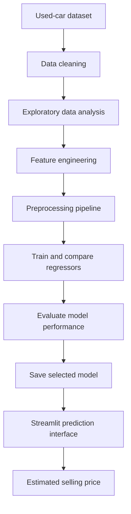

<div align="center">

# 🚗 Car Price Prediction

### Machine Learning for Used-Car Resale Price Estimation

A regression-based machine learning project that estimates used-car selling prices from vehicle details, with a Streamlit interface for interactive predictions.

<br/>


</div>

---

## 📌 Overview

Estimating a used car's resale value can be difficult because price depends on several factors, including its original price, age, usage, fuel type, transmission, seller type, and ownership history.

This project explores a supervised regression workflow for predicting used-car selling prices. It includes data cleaning, exploratory data analysis (EDA), feature engineering, preprocessing, model comparison, evaluation, and a Streamlit application for entering vehicle details and viewing an estimated price.

> **Prediction note:** The output is a model estimate based on the patterns in the training data, not a guaranteed market valuation.

## ✨ Features

- **Interactive predictions:** Enter vehicle details in a Streamlit interface.
- **Data preparation:** Check duplicates and missing values, engineer car age, and encode categorical features.
- **Exploratory analysis:** Review correlations and feature importance.
- **Model comparison:** Evaluate multiple regression algorithms rather than relying on a single model.
- **Performance evaluation:** Compare R², MAE, RMSE, and cross-validation R² where reported.
- **Visual analysis:** Use correlation, residual, feature-importance, and actual-versus-predicted plots.

## 🧭 Project Workflow



## 🗂️ Dataset and Features

The dataset contains vehicle attributes and a target variable, `Selling_Price`.

| Feature | Description |
|---|---|
| `Car_Name` | Car model name |
| `Year` | Manufacturing year |
| `Present_Price` | Current showroom price, in lakhs |
| `Driven_kms` | Total kilometres driven |
| `Fuel_Type` | Fuel category, such as petrol, diesel, or CNG |
| `Selling_type` | Dealer or individual seller |
| `Transmission` | Manual or automatic |
| `Owner` | Number of previous owners |
| `Selling_Price` | Target: selling price in lakhs |

### Data preparation

The documented preprocessing workflow includes:

1. Removing duplicate records and checking for missing values.
2. Creating `Car_Age = 2026 - Year`.
3. Dropping `Car_Name` and `Year` from the model features.
4. Applying one-hot encoding to categorical features.
5. Scaling numerical features with `StandardScaler`.
6. Combining preprocessing steps with `ColumnTransformer` and `Pipeline`.

**Implementation detail:** The reference year in the documented car-age feature is 2026. If the model is reused with newer data, keep the reference year consistent with the training and prediction pipeline.

## 📊 Model Comparison

The following scores are the results recorded for this project. Test R² is shown alongside training and cross-validation scores to make the differences in generalisation visible.

| Model | Train R² | Test R² | Cross-validation R² |
|---|---:|---:|---:|
| Linear Regression | 0.90 | 0.75 | 0.85 |
| Random Forest Regressor | 0.98 | 0.56 | 0.86 |
| Tuned Random Forest | 0.98 | 0.51 | 0.84 |
| Decision Tree Regressor | 1.00 | **0.83** | 0.88 |
| Tuned Decision Tree | 0.98 | 0.82 | **0.90** |
| LightGBM Regressor | 0.90 | 0.68 | 0.80 |

### Selected model: Decision Tree Regressor

The original evaluation selected the Decision Tree Regressor based on its test-set R² score.

| Metric | Reported value |
|---|---:|
| Test R² | **0.83** |
| MAE | 1.16 |
| RMSE | 2.17 |

MAE and RMSE are expressed in the target price's units (lakhs), assuming the evaluation was performed on the original, unscaled target. The reported scores should be reproduced against the project's evaluation code before being treated as independently verified.

### What the results suggest

- `Present_Price` is the strongest predictor in the recorded feature-importance results.
- `Car_Age` is the next most influential feature in that model.
- The Random Forest results show a substantial train–test gap, which may indicate overfitting.
- The tuned Decision Tree has the highest reported cross-validation R², while the untuned Decision Tree has the highest reported test R². Model selection should consider the validation strategy and reproducibility, not one score alone.

## 🔎 Feature Importance

The recorded Decision Tree feature importances are:

| Feature | Importance |
|---|---:|
| `Present_Price` | 0.927553 |
| `Car_Age` | 0.070450 |
| `Driven_kms` | 0.001997 |
| `Owner` | 0.000000 |
| `Fuel_Type_Diesel` | 0.000000 |
| `Fuel_Type_Petrol` | 0.000000 |
| `Selling_type_Individual` | 0.000000 |
| `Transmission_Manual` | 0.000000 |

These values are specific to the fitted Decision Tree and this dataset. A zero importance means the feature did not contribute to the model's recorded split-based importance; it does not prove the feature is never relevant to car prices.

## 📈 Visualisations

The repository includes these analysis plots:

| Visualisation | File |
|---|---|
| Correlation heatmap | [correlationmap.png](images/correlationmap.png) |
| Feature importance | [Feature Importance.png](images/Feature%20Importance.png) |
| Residual plot | [Resiudal Plot.png](images/Resiudal%20Plot.png) |
| Actual vs. predicted prices | [Actual vs Predicted Prices.png](images/Actual%20vs%20Predicted%20Prices.png) |

## 🖥️ Streamlit Application

The app accepts vehicle information and returns an estimated selling price in lakhs.

**Inputs documented for the app**
- Present price
- Kilometres driven
- Car age
- Fuel type
- Seller type
- Transmission type

**Output:** Estimated selling price.

### Run locally

1. Clone the repository and move into the project directory:

   ```bash
   git clone https://github.com/PrahitViraajReddy/Car-Price-Prediction.git
   cd Car-Price-Prediction
   ```

2. Create and activate a virtual environment (recommended):

   ```bash
   python -m venv .venv
   ```

   Windows:

   ```bash
   .venv\Scripts\activate
   ```

   macOS/Linux:

   ```bash
   source .venv/bin/activate
   ```

3. Install the project dependencies. If a `requirements.txt` file is present:

   ```bash
   pip install -r requirements.txt
   ```

   Otherwise, install the packages required by the project, including Streamlit, pandas, NumPy, scikit-learn, joblib, Matplotlib, Seaborn, and LightGBM as applicable to the code.

4. Start the app:

   ```bash
   streamlit run app.py
   ```

   Streamlit will print a local URL in the terminal; open it in your browser.

## 🧰 Technology Stack

- **Language:** Python
- **Data processing:** Pandas, NumPy
- **Visualisation:** Matplotlib, Seaborn
- **Machine learning:** Scikit-learn, LightGBM
- **Model persistence:** Joblib
- **User interface:** Streamlit

## 📁 Repository

Explore the source code, saved model artefacts, and analysis files in the [repository](https://github.com/PrahitViraajReddy/Car-Price-Prediction).

## ⚠️ Limitations

- The model reflects the dataset used during training and may not represent current market prices.
- Predictions depend on the quality and range of the training data.
- The reported metrics describe this project's recorded evaluation and are not a guarantee of performance on new vehicles.
- Feature importance describes the fitted model; it does not establish causation.
- The documented car-age calculation uses a fixed reference year (2026), which should be updated consistently if the project is retrained for a later period.

## 👤 Author

**Prahit Viraaj Reddy Madupu**

- GitHub: [@PrahitViraajReddy](https://github.com/PrahitViraajReddy)

---

<div align="center">

*Built as a machine learning project exploring used-car price estimation.*

</div>
